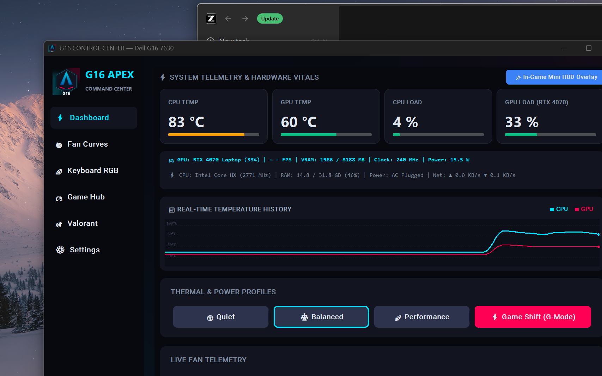
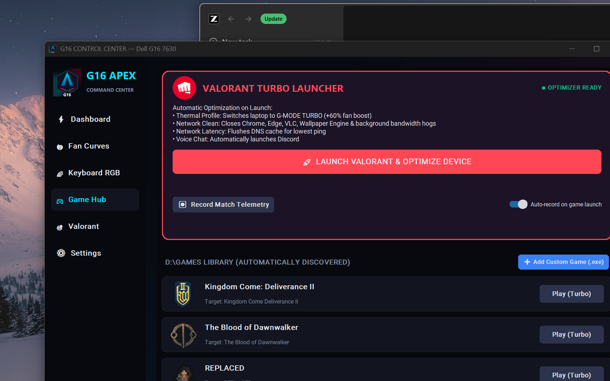
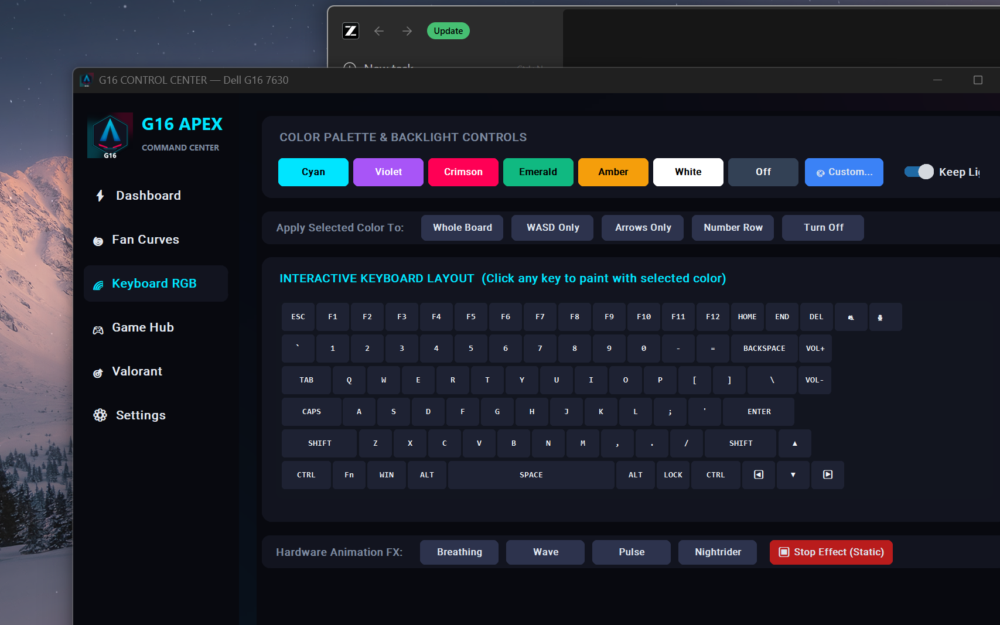
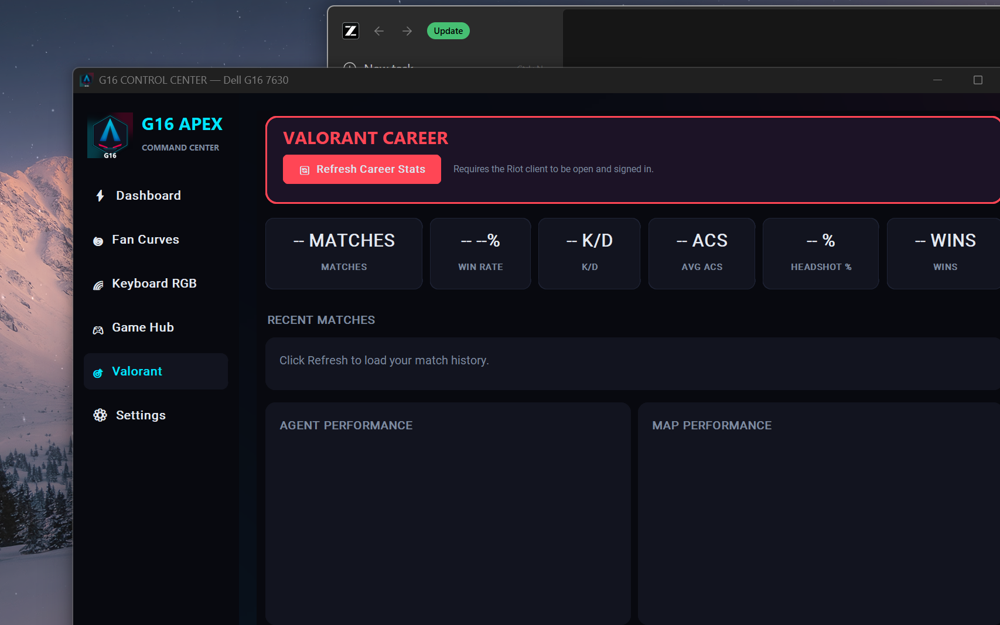

# G16 APEX Control Center


A sleek, lightweight, open-source replacement for **Alienware Command Center**
on the **Dell G16 7630** — fan control, per-key keyboard RGB, live hardware
telemetry, match telemetry recording, and a game launcher with an automatic
turbo optimizer. Zero Dell software, zero background services, zero telemetry.

## Screenshots

| Dashboard | Game Hub |
|---|---|
|  |  |

| Keyboard RGB | Valorant Career |
|---|---|
|  |  |

## Features

- ⚡ **Live dashboard** — CPU/GPU temps, real effective CPU clock (PDH),
  GPU util/VRAM/clock/power (native NVML), RAM, network, rolling temp history
- 🌀 **Fan control & curves** — thermal modes (incl. G-Mode) + additive fan
  boost via the BIOS WMI interface; dedicated fan-curve daemon with a
  critical-temperature fail-safe
- 🌈 **Per-key RGB** — native USB HID driver for the Darfon keyboard
  (84 addressable keys), interactive on-screen keyboard layout, always-on
  backlight keepalive, hardware effects
- 🎮 **Game Hub** — auto-discovers installed games, one-click Turbo launch
  (G-Mode + fan boost), per-game telemetry recording with live FPS
  (Intel PresentMon)
- 🎯 **Valorant career stats** — rank, RR climb, per-agent/per-map win rates,
  headshot %, recent matches (on-demand via Riot's official API)

## Requirements

- Dell G16 7630 (likely works on G15/G16 siblings — untested)
- Windows 10/11, run as Administrator (scheduled-task launcher provided)
- Python 3.10+ with: `pip install customtkinter pillow pywin32 wmi hidapi psutil`

## Quick start

1. Run `g16fan-install.cmd` as administrator once (registers the elevated
   launcher task — no UAC prompts afterwards)
2. Launch **G16 Control Center** from the Start Menu
3. Optional standalone daemon: `g16fan-daemon.bat` (fan curves + tray icon)

## Project layout

| Path | What it is |
|---|---|
| `app.py` | Control Center GUI (CustomTkinter) |
| `backend.py` | Threaded hardware engine (WMI + NVML + HID + PDH) |
| `awcc.py` | Dell BIOS WMI protocol module |
| `g16rgb.py` / `g16rgb` driver | Darfon per-key RGB HID driver (APIv5) |
| `g16ctl.py` | Headless CLI for all thermal/fan control |
| `g16fan.py` | Standalone fan-curve daemon |
| `optimizer.py` | Game discovery + launch optimization engine |
| `valcareer.py` | Riot API career-stats client (read-only) |
| `game_art.py` | Game icon extraction / placeholder art |
| `mappings/devices.csv` | G16 7630 per-key light map (community data) |
| `research/` | Protocol notes + upstream references |

## How it works (no black boxes)

- Fans/thermal/G-mode: Dell's `AWCCWmiMethodFunction` WMI class in `root\WMI`
  — the same ACPI interface Alienware Command Center uses. Fan boost is
  *additive* on top of the EC's own curve; hardware protection always wins.
- Keyboard RGB: the internal keyboard is a Darfon controller (USB
  `0D62:CCBC`, AlienFX APIv5). We speak its HID feature-report protocol
  directly — no AWCC, no vendor drivers.
- GPU telemetry: native NVML (`nvml.dll`) via ctypes — no subprocesses.
- CPU clock: Windows PDH performance counter (`% Processor Performance`).
- Valorant stats: Riot's official API authenticated by your own running
  client (lockfile) — read-only, nothing leaves your machine.

## Safety

Fan boost values are additive on top of the EC firmware's own curve — the
embedded controller's thermal protection can never be overridden. The TCC
health guard only *lowers* the CPU's maximum temperature. Verified live:
2.5-hour sessions pinned at the guard with zero thermal events.

## Credits

- [tcc-g15](https://github.com/AlexIII/tcc-g15) — WMI protocol documentation
- [T-Troll/alienfx-tools](https://github.com/T-Troll/alienfx-tools) —
  AlienFX SDK + device mappings (MIT)
- [Intel PresentMon](https://github.com/GameTechDev/PresentMon) — frame
  capture for live FPS (bundled separately in `tools/presentmon/`)
- [valorant-api.com](https://valorant-api.com) — content name resolution


## Contents

| Path | What it is |
|---|---|
| `g16ctl.py` | CLI: temps, fan RPMs, thermal modes, fan boost |
| `g16fan.py` + `g16fan.json` | Fan-curve daemon with critical-temp fail-safe + tray icon |
| `g16rgb.py` | **Per-key keyboard RGB driver (AWCC-free, verified)** |
| `g16fan-daemon.bat` | Launch daemon with tray icon (self-elevates) |
| `g16fan-install.cmd` | One-time setup: auto-start daemon at every logon |
| `awcc.py` | Shared WMI protocol module |
| `test-elevated.cmd` | One-shot validation script |
| `tools\` | alienfx-tools + OpenRGB + PawnIO |
| `research\` | Protocol docs + reference implementations |
| `test-output.log` | Verified results from the last elevated run |

**Verified working:** fan control via BIOS WMI (temps, RPMs, thermal modes
with USTT fallback, G-mode, fan boost) + **per-key RGB via native HID
feature reports** on the Darfon keyboard (VID 0x0D62 PID 0xCCBC, APIv5).

## Verified on this machine (G16 7630, 2026-09-17)

- Fans discovered: CPU = fan ID 50 (sensor 1), GPU = fan ID 51 (sensor 6)
- Fan RPM + temperature reads work; duty-% subcode unsupported (shows `--`)
- Thermal modes work with **USTT codes**: balanced=0xA0, performance=0xA1,
  quiet=0xA3 (classic codes 150-152 are rejected — `g16ctl` falls back
  automatically). G-mode (0xAB) works directly.
- `SetAddonSpeedPercent` fan boost works and is measurable (4219 -> 4460 RPM
  at 40%), clears cleanly
- alienfx-tools `alienfan-cli` reports: *"Supported hardware detected,
  2 fans, 13 sensors, 5 power states, G-Mode, TCC, XMP"* — the machine is
  fully supported by alienfx-tools for fan/power/TCC/XMP control

## Requirements

- Windows 10/11, **Administrator prompt** (the WMI thermal class is admin-only —
  same privilege AWCC itself runs with)
- Python 3.10+ with `pywin32` + `wmi` (`pip install --user pywin32 wmi`)

## Usage

```text
python g16ctl.py status            # fan RPMs, duty %, related sensor temps
python g16ctl.py sensors           # dump all thermal sensors the EC exposes
python g16ctl.py watch [seconds]   # live view (default 2 s refresh)
python g16ctl.py mode balanced     # quiet | balanced | performance | fullspeed
                                   # custom | gmode (+ ustt_* variants)
python g16ctl.py boost 60          # raise both fans by +60% addon duty
python g16ctl.py boost 60 cpu      # CPU fan only (or gpu)
python g16ctl.py boost off         # clear boost, restore balanced mode
```

`boost` switches to `custom` thermal mode first (that is how manual fan
control behaves on this platform, matching tcc-g15's findings).

## How it works

The EC firmware exposes a WMI method class with subcommand-encoded uint32
arguments (protocol documented by the [tcc-g15](https://github.com/AlexIII/tcc-g15)
project, `research\WMI-AWCC-doc.md`):

- `Thermal_Information` subcodes: sensor temp `(id<<8)|4`, fan RPM `(id<<8)|5`,
  fan duty % `(id<<8)|6`
- `GetFanSensors`: discover fan IDs (49–99) and their related thermal
  sensors (1–48)
- `Thermal_Control` subcodes: set mode `(mode<<8)|1`, fan addon boost
  `(pct<<16)|(fan<<8)|2`

Thermal modes: `quiet=150 balanced=151 performance=152 fullspeed=153
custom=0 gmode=171` (plus USTT variants 160–165 on some firmware).

## Safety

- `SetAddonSpeedPercent` is a *boost on top of* the EC's own fan curve — it
  cannot hold fans below the BIOS curve. The EC's thermal protection stays
  active no matter what we send.
- Every write is per-fan and reversible (`boost off` / `mode balanced`).
- No power-limit, voltage or overclock values are touched by this tool.

## Overclocking (replacing the rest of AWCC)

- **GPU:** MSI Afterburner — full curve/OC control, independent of AWCC.
- **CPU:** undervolting is locked by Dell BIOS (Plundervolt mitigation) on
  the 7630; ThrottleStop can still manage turbo behaviour. BIOS OC knobs do
  exist over this same WMI interface (`BIOSOCControl`, `MemoryOCControl`,
  `TccControl`) — a possible future addition once the argument encoding is
  reverse-engineered.

## Fan curve daemon

```text
python g16fan.py            # run with g16fan.json curves, Ctrl+C to stop
python g16fan.py --tray     # with tray icon (color = CPU temp; menu: pause,
                            #   trigger fail-safe, quit-restores-balanced)
python g16fan.py --once     # single evaluation cycle, then exit
python g16fan.py --dry-run  # compute targets without writing
```

- Curves are piecewise-linear `[temp, boost%]` points per fan in
  `g16fan.json` (auto-created with sane defaults on first run).
- Boost = *additive* on top of the EC's own curve; the EC safety overlay
  always stays in force.
- **Fail-safe**: any sensor >= `critical_temp` (default 95C) switches the
  machine to G-mode immediately; control resumes below
  `critical_temp - critical_hysteresis` (default 90C). Validated live: it
  caught a 99C CPU instantly and cleaned up to balanced on exit.
- The daemon always restores boost-0 + balanced mode on exit (Ctrl+C, stop,
  or crash of the wrapper).
- Log: `g16fan.log`.

## Keyboard RGB — native driver

`g16rgb.py` drives the internal keyboard directly: the G16 7630's keyboard
is a **Darfon per-key RGB unit** (USB `VID_0D62 PID_0CCBC`, HID usage 0xCC,
AlienFX API v5) — the same hardware AWCC's lighting module talks to.

**Verified 2026-09-17:** keyboard turns blue/red/green/white on command.

```text
python g16rgb.py set 255,0,0            # whole keyboard red
python g16rgb.py set 0,255,0 W A S D    # only named keys (see 'list')
python g16rgb.py off
python g16rgb.py effect breathing 0,0,255   # hardware effects: breathing,
                                            # wave, pulse, nightrider, laser
python g16rgb.py list                   # 84 mapped keys with light IDs
```

Protocol (from the MIT-licensed T-Troll AlienFX-SDK, see `research\`):
HID **feature reports**, report ID `0xCC`; color blocks `CC 8C 02` +
`[light+1, r, g, b] * 15` per 64-byte report; set-end `CC 8C 13`; apply
`CC 8B 01 FF`; reset `CC 94`. The key map (`tools\Mappings\devices.csv`,
"DELL-G16 7630" section) maps 84 key names to light IDs 0..113.

Investigation notes: no USB 187C controller exists on this machine (the
`3554:F58A` device is a wireless mouse dongle — red herring), OpenRGB
finds nothing even with PawnIO because the controller is not on the SMBus —
it's the keyboard itself. `alienfx-cli status` reveals it as
"DELL Technologies Keyboard, APIv5".

## Auto-starting the daemon

Run `g16fan-install.cmd` **once as administrator** — it creates a
"G16FanDaemon" scheduled task that starts `g16fan.py --tray` at every logon
with highest privileges (no UAC prompt each time). To remove it:
`schtasks /delete /tn G16FanDaemon /f`.

For manual runs, `g16fan-daemon.bat` self-elevates and hides the console.

## Roadmap ideas

1. ~~Fan-curve daemon + tray icon~~ **done** (`g16fan.py`)
2. ~~Keyboard RGB~~ **done** (`g16rgb.py` — native per-key control)
3. TCC offset control (cap CPU temp below 100C — `alienfan-cli settcc`
   already proves the firmware exposes it; same WMI `TccControl` method)
4. MUX switch control (`MUXSwitch` WMI method, encoding unknown)
5. RGB profiles: save/load named color schemes, hotkey cycling,
   CPU-temp-reactive lighting (our HID driver + temp reads make this easy)
6. MUX switch control + autostart polish

## Daily use today

- Fan control: `python g16fan.py --tray` (our daemon, self-elevating
  `g16fan-daemon.bat`, or auto-start via `g16fan-install.cmd`)
- Keyboard color: `python g16rgb.py set r,g,b` or `list`/`effect`
- GPU tuning: MSI Afterburner
- Nothing from Dell needs to be installed — this suite replaces AWCC
  entirely on your hardware.

## Credits

- [AlexIII/tcc-g15](https://github.com/AlexIII/tcc-g15) — WMI protocol docs
  and reference implementation (GPL-3.0; this project's protocol knowledge
  derives from it)
- [T-Troll/alienfx-tools](https://github.com/T-Troll/alienfx-tools) —
  ready-made lightweight AWCC replacement (MIT), included in `tools\`
